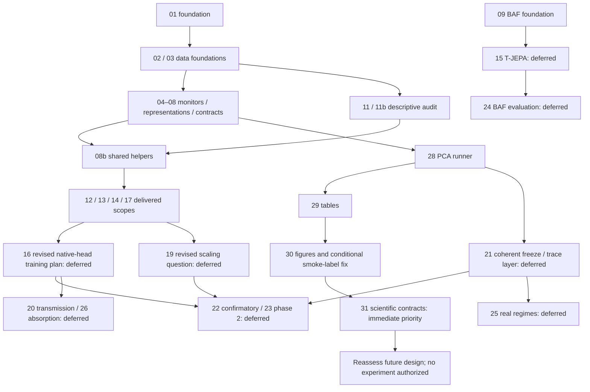

# Streams 01–27: evidence and relevance audit, 2026-11-06

Scope: streams 01–27, including 08b and 11b. This audit authorizes no experiment. The immediate execution priority is stream 31. No additional historical code stream is selected for launch. New PCA experiments without an oracle, real-data experiments, JEPA training, VAE and J4 execution remain outside this mandate.

## Evidence rules and inspected state

The initial inspection was read-only. Main, its local remote-tracking reference and the remote main advertised by `git ls-remote` all resolved to `a0c576e13e8e647dfd61350eec52058ffc794dbf`. The only non-ignored untracked file in the main worktree was `prompts/streams/00_CODEX_AMORCAGE_REPRISE_2026_11_06.md` (SHA-256 `d1f2c23477392f927a92cf5127403d2dae49da0987cebf94974276105124925e`). No staged change or unpushed main commit was found.

Sources are the exact stream prompts, plans, GO files, wrapups, tracked code/test paths, output hashes and Git ancestry. `INDEX.md` and handover section 3.6 are historical routing evidence, not current launch orders. Every delivered commit listed below was checked with `git merge-base --is-ancestor <commit> main`. A wrapup alone is not used as merger evidence.

`CLOS_VALIDÉ` below means the delivered engineering or expressly archived scope has merger evidence and recorded test evidence. It does not certify every scientific hypothesis, later optional phase, private-data availability or a new reproduction run. Current baseline verification is recorded separately; it must not be confused with the archived tests.

Workflow abbreviations in the tables: P = `prompts/plans/plan-<id>.md`; G = `prompts/GO-stream-<id>.md`; W = `prompts/wrapups/wrapup-<id>.md`. An explicit absence is a documentation gap, not evidence that code is absent. `11b` has no standalone stream prompt: G11b is its specification and its wrapup was consolidated into W11 by commit `3b77562`.

## Delivered scopes: evidence matrix

The prompt alias for each ordinary row is `prompts/streams/prompt-<id>-<slug>.md`, as named below. Code and test paths are relative to the repository. Test statements in this table are archived evidence, not newly executed results.

| Canonical ID / prompt alias | Object and code/test evidence | Plan / GO / wrapup | Results and commit on main | Dependencies / relevance / cost and risk / decision |
|---|---|---|---|---|
| 01 / socle-e2 | `jepadrift/floors.py`, `experiments/e2_floor_validation.py`, `tests/test_floors.py` | P/G absent; W01 present | `320dea7`; E2 CSV and J1 report; W01 records six floor tests and make check | Root dependency. Retain sealed numerical reference; rerun redundant and unauthorized. `CLOS_VALIDÉ` for delivered lot 1/J1. |
| 02 / data-d1-d2 | `data_loader/articleB.py`, `tests/test_data_d1_d2.py` | P/G absent; W02 present | `aa3a155`; manifest, D1/D2 profiles; W02 records 15 targeted / 21 total tests | 01 delivered. Existing data foundation; no rebuilding or downloading. `CLOS_VALIDÉ`. |
| 03 / data-d3 | `data_loader/sp500.py`, `tests/test_data_d3.py` | P03/G03/W03; temporary plan also retained | `3e3a804`; D3 panels/profile/manifest; W03 records 42 tests | 01 delivered. Retain survivorship and static-GICS qualifications. Known characteristic defects are separate future work. `CLOS_VALIDÉ` for the archived build. |
| 04 / monitors-core | `monitors/`, `stats/garch.py`, `tests/test_monitors.py`, `tests/test_identity_articleB.py` | P04/G04/W04 | `b74ad6c` plus fixes; Article B R01/R08 identity CSV; W04 and aggregate W01–11 record identity/tests | 01/02 delivered. Reused by 31; no replacement. Exactness stays within its declared null. `CLOS_VALIDÉ`. |
| 05 / injections | `sim.py`, `injection.py`, `tests/test_injection.py` | P05/G05/W05 | `cbd0692` plus fixes; W05 records invariant checks; J1 hash retained | 01/02/03 delivered. Reuse helpers, no new injections campaign. Student/D6 design information is not exact Gaussian KL. `CLOS_VALIDÉ`. |
| 06 / representations-z | `representations/{base,pca,cross_section,extract}.py`, `tests/test_representations.py` | P06/G06/W06 | `eae6f33` plus fixes; reference extraction sidecars and tests | 02/03 delivered. Reuse Z-1 and PCA; MP uses correlation and PC1 remains explicit. `CLOS_VALIDÉ`. |
| 07 / pipelines | `pipelines.py`, `tests/test_pipelines.py` | P07/G07/W07 | `d5aa364`, `be7d938`; R15 identity CSV; W07 records 186 tests and 54 focused checks | 04/05/06 delivered. Reuse, no second pipeline registry. Even-stream D6 diagnostics are not independent FPR evidence. `CLOS_VALIDÉ`. |
| 08 / contracts | `tests/test_contracts.py`, `tests/test_decoupling.py`, Git hooks | P08/W08; standalone G08 absent | `f7bde91`, corrected by `8ae232e`; W08 documents interpreter and torch-skip incidents and later passing checks | 04–07 delivered. Active regression barrier; historical test report must include its corrections. `CLOS_VALIDÉ`. |
| 08b / hygiene | `data_loader/chars.py`, `stats/drift.py`, `tests/test_chars.py`, `tests/test_drift_stats.py`, prompt checker | P08b/G08b/W08b | `24be667`, integrated by `33d847d`; W08b records 228 passed / 4 skipped and unchanged audit CSVs | 07/08/11 delivered. Shared helpers already exist; do not recreate them. Prompt discovery gap belongs to the separately gated 31 tooling lot. `CLOS_VALIDÉ` for original scope. |
| 09 / baf | `data_loader/baf.py`, `tests/test_data_baf.py` | P09/G09/W09 | `611a1b9`; BAF profile, split and preprocessing artifacts | 01 delivered. Dataset foundation only; full PCA does not evaluate BAF. No BAF training/evaluation now. `CLOS_VALIDÉ`. |
| 10 / eurofidai | `data_loader/eurofidai.py`, synthetic fixtures, `tests/test_data_eurofidai.py` | P10/W10; standalone G10 absent | `672ce26` plus manifest correction; tracked extraction spec/schema/hash manifest; W10 records fixture checks and an older unrelated D3 failure | 01 delivered. Proprietary inputs stay local; current private-data checks may be unavailable in worktrees. No extraction or rebuild now. `CLOS_VALIDÉ` for delivered loader/specification, not a new D4 reproduction. |
| 11 / audit | `experiments/audit_information.py`, `tests/test_audit.py` | P11/G11/W11; obsolete `plan-11-vibe.md` is not a current plan | `9a36c2f`, `985353b`; nine audit CSVs and figures; aggregate W01–11 records 31 audit tests | 02/03/06 delivered. Descriptive historical audit; predicted-gains NaN stay NaN. No rerun. `CLOS_VALIDÉ`. |
| 11b / G11b specification | Same audit implementation/tests, noise/placebo refinements | P11b/G11b; W folded into W11 by `3b77562` | `4974815`; placebo-selection CSV hash checked below | 11 delivered. Selection bias remains binding; cannot infer prospective detectability from dated boundaries. `CLOS_VALIDÉ`. |
| 12 / e1 | `experiments/e1_problem.py`, `tests/test_e1.py`, `configs/e1.yaml` | P12/G12/W12 | `ecf4ab3`, integrated by `77991ac`; E1 CSV hash checked; W12 records 18 E1 tests and 284 passed / 8 skipped overall | 02–08/08b/11 delivered. J2 criteria reported; nominal targets are not attained-FPR equivalence. Full PCA is a different experiment. `CLOS_VALIDÉ`, no rerun. |
| 13 / e3 | `experiments/e3_calibration.py`, `tests/test_e3.py`, intervals | P13/G13/G13-archive/W13 plus STOP trace | `1dcc392`, integrated by `4811bda`; overshoot CSV checked; W13 records 295 passed / 8 skipped | 04–08/08b delivered. Archive GO closes engineering while preserving D8 FAIL. No retuning/reseeding/reinterpretation. `CLOS_VALIDÉ` for archived scope, scientific D8 remains FAIL. |
| 14 / ca-tjepa, superseded by native-bottleneck rewrite | `jepa/{ca_tjepa,representation}.py`, `experiments/jepa_pretrain.py`, `tests/test_ca_tjepa.py` | P14 and B2 revision 6; G14 A/B/B2/C4/J1; W14 | `67437b3` at branch tip, integration `779e3fb`; W14 records real guards, native J1 restoration and make check | 03/06/08/08b and shared extraction from 17 delivered. Code delivery does not close campaign 16 or J3. No JEPA work now. `CLOS_VALIDÉ` for implemented architecture only. |
| 17 / ipca | `representations/ipca.py`, `experiments/ipca_k_selection.py`, `tests/test_ipca.py` | P17/G17/G17-D3/W17 | `6ed8f8a`, integration `b95f077`; K-selection CSV checked; W17 records 298 passed / 4 torch skips | 03/06/08b delivered. P4-C exists; P4-D remains uncalibrated and outside calibrated J4 comparisons. `CLOS_VALIDÉ` for explicit engineering scope, no new null control. |
| 27 / e10 | `experiments/e10_robustness.py`, `tests/test_e10.py`, `configs/e10.yaml` | P27/G27/W27 | `57c3a34`, integrated by `c284823`; E10 CSV checked; W27/handover record 13 E10 tests and make check | 05/07 delivered. F1 linear phase closed; F2 and P5 extensions are not silently included. No restart. `CLOS_VALIDÉ` for delivered F1 scope. |

The library paths abbreviated above start with `jepadrift/`. Workflow gaps for the early streams are retained as historical gaps; no retroactive plan or researcher signature is fabricated.

## Unclosed scopes and explicit decisions

| Canonical ID / alias and object | Plan/GO/wrapup, code and results on main | Dependency state | Relevance after full PCA; cost, risk and redundancy | Decision and verifiable reason |
|---|---|---|---|---|
| 15 / tjepa-baf: tabular T-JEPA | No P/G/W; `jepa/tjepa.py`, `experiments/tjepa_baf.py` absent | 09 and torch foundation 14 delivered; training/evaluation not delivered | BAF is a separate domain, not tested by full PCA. Training cost and new statistical protocol; no present finance priority | `DIFFÉRER`. No launch in this mandate. |
| 16 / pretrain-rankme: campaign/J3 | No P/G/W; `experiments/jepa_campaign.py` and `results/jepa_pretrain/J3_gate.txt` absent; 14 has smoke/reader code only | 14 engineering exists; campaign and frozen trained models absent | Historical prompt requires post-JEPA PCA and contains inconsistent run counts. Native bottleneck is required by the accepted 14 rewrite. Dataset characteristic defects also need explicit future treatment | `À_REPLANIFIER`. Rewrite design and plan before any future training; no training now. |
| 18 / cddfm: external baseline | `d8e644b` is on main; `docs/sections/cd_dfm.md` exists. No P/G/W, adapter or adapter test on main | External clone at `37a1dfb39974884df822aa2994854bbf1270e381`; referenced `data.dataset`/`preprocess_panel` and license file not found | Documentary exclusion exists. No executable external comparator; do not infer superiority of JEPA or reconstruct missing upstream code | `BLOQUÉ` for model integration. Keep documentary result; workflow closure trace remains incomplete. No new adapter or dependency installation. |
| 19 / e4-p3kf: scaling in N/SPLL | No P/G/W; `experiments/e4_scaling.py`, `monitors/spll.py` absent | 05/07/08b/11/17 engineering delivered; comparator/null choices still need review | Historical N-scaling grid differs from full PCA k-prefix benchmark. Possible future appendix; expensive and potentially redundant without a new question | `À_REPLANIFIER`. Evaluate necessity and update protocol after 31; no automatic run. |
| 20 / transmission: Jacobian and dictionary diagnostics | No P/G/W; transmission/dictionary scripts absent | 16 trained representations absent; 18 unavailable | Cannot measure learned transmission without trained encoders; method comparison would require fresh experiments | `DIFFÉRER`. Dependency and mandate both exclude execution. |
| 21 / freeze-runner: J4 freeze and traceability | No P/G/W; `benchmark_runner.py`, `freeze_config.py`, `FROZEN.json`, `docs/MAPPING.md` absent | 12/13 delivered, including archived failures; future configuration/comparators not ready | 28–30 already supply a PCA runner, tables, figures and lineage. Need one coherent freeze/trace layer, not a second incompatible runner | `À_REPLANIFIER`. Freeze remains required before real 2020+ experiments; do not produce it now. |
| 22 / e5: confirmatory JEPA | No P/G/W; `experiments/e5_jepa.py` absent | 16/19/21 and 23 phase 2 absent; 17 P4-D not calibrated | No frozen configuration or qualified trained comparator set. Historical prompt is superseded by the J4 rewrite | `DIFFÉRER`. No confirmatory or test-window work. |
| 23 / e6: F4 phase 1, then P4-D/P5-D | P23/G23/G23-audit/W23, code/tests/CSV/figures exist only in worktree/branch 23, not main | Phase 1 used 05/07 at an older base; P4-D addition now faces 17 null limitation; P5-D needs 16 | Two unique commits, 35 main commits missing. D6 FPR is in-sample/descriptive; large PC1–PC2 ratios depend on unilateral index blindness. Full PCA already covers related diagnostics, but not every E6 scenario | `DIFFÉRER` integration and further execution. Preserve phase 1; future targeted compatibility review can use a new isolated checkout, without changing owner worktree. No automatic merge or JEPA phase. |
| 24 / e9: BAF Data/Concept | No P/G/W; `experiments/e9_baf.py` absent | 09 exists; 15 absent | Separate tabular domain, not evaluated by PCA full. Requires T-JEPA, conformal/null/order decisions | `DIFFÉRER`. No BAF experiment. |
| 25 / e8: dated real regimes | No P/G/W; `experiments/e8_real_regimes.py` absent | 08b exists; 21 freeze absent | Retrospective selection/survivorship and null limitations apply. Real-data gate remains closed | `DIFFÉRER`. No historical-event experiment or 2020+ access. |
| 26 / e7: absorption/ageing | No P/G/W; `experiments/e7_absorption.py` absent | 14 code exists; 16 trained models absent; later years need 21 | New adaptation/training experiments and validity questions; no immediate bearing on sealed PCA contracts | `DIFFÉRER`. No adaptive model work. |

No `ABANDON_DOCUMENTÉ` is assigned to an entire historical stream. Deferral is not abandonment. CD-DFM's documented exclusion from the primary J4 gate is narrower than abandoning every possible future documentary follow-up.

## Worktree and session inventory

| Worktree suffix | Branch / HEAD at preflight | Divergence from main | Occupation and retained state |
|---|---|---|---|
| Principal | main / `a0c576e` | 0 ahead, 0 behind | Current Codex orchestration; one untracked researcher bootstrap prompt |
| full-2000 | ops/pca-full-2000-20261101 / `1af0862` | 1 ahead, 1 behind | No live benchmark; README-only commit is not merged; untracked full `trials.csv` retained |
| stream-23 | stream-23 / `3d0bd20` | 2 ahead, 35 behind | Clean tracked tree; no active Claude; untouched throughout inspection |
| stream-28 | stream-28 / `fc533d0` | 0 ahead, 6 behind | Clean tracked tree; historical logs retained |
| stream-29 | stream-29 / `6f9322b` | 0 ahead, 5 behind | Clean tracked tree |
| stream-30 | stream-30 / `b025450` | 0 ahead, 4 behind | Clean tracked tree; no process writing figures |
| stream-31 | stream-31 / `fc533d0` | 0 ahead, 6 behind initially | Old PLAN.md is only a weekly-limit refusal; no QA code/GO/plan. After read-only report, advanced by fast-forward to `a0c576e`; old ignored traces preserved |

At preflight, tmux sessions 0–5 existed; no Claude Code process or PCA benchmark was active. An unrelated editor Vibe ACP process was not treated as an authorized stream. The old weekly-limit message dates from 2026-10-31 and is not evidence of current quota availability. Following the explicit resumption instruction, one interactive session `jepa-s31` was opened with Claude Code 2.1.318, `claude-opus-5-5`, effort `max`, permission mode `plan`, named Remote Control and Agent/Task tools disabled. Its first assignment is read-only plan production, with no exit from plan mode before review. No second stream was launched.

Local historical plan-only/standby guards are preserved as evidence. The researcher's current instruction explicitly resumes 31 and authorizes interactive Claude implementation after an audited written GO. It does not retroactively change the older 28–30 decisions.

## Dependencies and launch order

Immediate lane 1: 31 read-only Claude plan -> Codex review/questions -> canonical French plan and explicit GO -> isolated QA implementation -> actual unit/integration checks -> English validation/wrapup -> supervised Git closure. Tooling ownership requires its own GO and preferably an independent commit. Immediate lane 2: this documentary audit, performed by Codex. No historical code stream has both a necessary current question and an execution GO; therefore no additional historical stream is launched. Maximum two Claude sessions includes planning, implementation and delegated review, with no nested swarm.

## ID collision and prompt-checker gap

The real current discovery is only `STREAMS.glob("prompt-*.md")`. The initial command `make prompts-check`, using the project environment, returned `29/29`; this excludes all four new PCA files. The master includes legacy `PROMPT 28` Electricity, but no `28-PCA`, `29`, `30` or `31` blocks. The runner title is already `PROMPT 28-PCA`, explicitly authorized in G28. Preserve that identity and the legacy 28; do not rewrite either prompt to satisfy the stale literal 28 requirement in the QA prompt.

Expected discovered set after a separate tooling GO: 29 legacy files plus four PCA files = 33. The change must reject duplicate IDs/aliases, missing expected PCA files, changed canonical text, truncated master and duplicate master blocks before mutation. A controlled sync must preserve archived blocks and be idempotent. A missing/modified prompt must fail instead of shrinking the denominator. No blind `--sync-master` or claim of complete synchronization is authorized before the tooling review.

Legacy stream 28 (`prompt-28-e11.md`, Electricity/D8) is outside the 01–27 matrix and outside the current finance priority. It is a separate deferred historical task, not an alias of 28-PCA, and is not launched.

## Integrity and available artifacts

Hashes recomputed without rerunning experiments:

| Artifact | SHA-256 |
|---|---|
| E2 native CSV, disk and Git index | `e315e537ead0f656e4bcd3897e6ff04075f3780a8fbe642e258864739b570823` |
| E1 cells | `9ae7e261aada263c29fc446f3d3ad17577d9bbe553804db76069e423268cb8f3` |
| E3 overshoot | `1ca7c3aea355e42910c828b8fa1b7f40acf9846d99953a5e93136e457e4d68b3` |
| IPCA K selection | `1e91128958cf5796d3e5949b2ffc23e4df6cb6185bfab349e47b9225381ba38e` |
| E10 cells | `9998f9422794078a515a7ba1a2701802ef9e162b3d183e42fc71e3ec1799da56` |
| Audit placebo selection | `9d56e2ca8ca1f358735c4a19a2878597893a6251d4823a9c357544f0d4e1eac0` |
| E6 phase 1, branch 23 only | `4101c867bd3e6bc885d8d03845cda6ac033aa60e02ca94d4d45948166c59d249` |
| Full manifest | `3b2299bc1c841ef5c9f425a135ad9e318b310c08acfbfaf228a0b49034372f47` |
| Full trials, neighboring full worktree only | `40b5f8919684bce13b266a83fe0ddf3e5ff295a6330a15c0fe9cbf5deb310b5c` |

The full run fingerprint is `ea702d03b9faf332d0ae74a7746422189b92854fbe728ceff9cb842a3ce7985a`. Its trials file has 48,317,020 bytes and 716,000 recorded rows according to the manifest; the byte size and SHA were checked on disk. It is not copied into QA fixtures or proposed for Git tracking. Five present runner CSV hashes, eight table-output hashes and sixteen corrected figure-output hashes match their manifests. Table/figure PASS statements in the archived validation documents are not presented as newly rerun integration tests.

Corrected full figure render tags contain no effective `SMOKE_NO_CLAIMS`; the preserved static spec metadata still records its original tags. Covariance output retains `COV_SURROGATE_EXPLORATORY`. Recorded descriptive FPR mismatches are k=12 for Gaussian mean and k=14 for Student mean. These facts do not authorize changing plots or claiming attained-FPR equality.

D8 remains `FAIL` for `iid/first_order_d1_l3`, relative gap `0.052833421330517272` (>0.05). No experiment, reference, threshold or tolerance is changed. P4-D's archived zero-alarm D6 check remains an in-sample diagnostic, not an independent FPR estimate.

## Remaining gates

- Current baseline `make check`: completed with exit 0 in worktree 31 on unmodified `a0c576e`, log `logs/orchestration_reprise_20261106/baseline-make-check.log`. Contracts/decoupling: 37 passed in 36.66 s, including the four live torch guards. Remaining suite: 538 passed, 5 skipped in 450.90 s. Overall: 575 passed, 5 skipped. This exceeds the five-minute engineering target and remains a performance debt; no test was omitted to meet it.
- Plan 31 v1 was produced in native plan mode and archived byte-identically (562 lines; SHA-256 `34f07a35ee96abe7e24eb268224b2d75a2da6d653f214ef4c494c5ea437fa01d`). Codex recorded `prompts/NO-GO-stream-31.md`, answered Q1–Q12 and requested v2 before any code. Corrections include the 0/1-based axis round-trip, calibration assertions, unavailable/observed counters and minimal prompt-sync semantics. Native v2 (527 lines; SHA-256 `a82a231d458a27e3b4affe6e8dae56a71588d3cedfea8c8b110006b1317972f7`) was then reviewed, archived unchanged and persisted in `prompts/plans/plan-31.md` with the integrated GO decision. On 2026-11-06 at 09:42 UTC, `prompts/GO-stream-31-tooling.md` authorized only tooling lot 1. The same interactive session left plan mode through the official CLI control; its displayed permission mode is auto, with the same model/effort and no bypass-permissions flag. It must stop after TDD, controlled master migration, make check and the lot-1 wrapup for Codex review. QA lot 2 remains unauthorized until a separate GO after the independent tooling commit. Missing integration trajectories elsewhere must be BLOCKED separately; offline mathematical tests remain runnable.
- A presentation defect was reproduced read-only in the archived full PDF: its descriptive FPR note says `n = 40`, although the manifest declares 2000 paths per role. The producer source contains that literal. No producer or sealed figure was modified. A scientific/numerical or provenance contract failure remains subject to STOP; a figure correction would require a separate researcher GO.
- Prompt synchronization was exercised only in memory: 33 discovered source files, first sync append-only, second sync not identical (136069 -> 184889 -> 184875 characters). The unfenced final 8b block absorbs the following opening fence. All 29 legacy block bodies matched their sources and the on-disk master remained unchanged. Tooling must cover this defect before migration.
- Future scientific blockers: characteristic beta-denominator/phantom-rank defects (`C-D3-beta-denominator`, `C-D3-chars-phantom`), even-stream null reuse (`C-P4D-null-insample`), outdated 16/22 prompts, missing freeze and qualified trained models. They require future scoped plans/GOs; none is repaired here.
- Public repository metadata was checked through the connected GitHub repository tool. `C-push-policy` explicitly distinguishes public visibility from public dissemination of the address. Before any push, inspect the actual range, anonymity, protected paths and file sizes, and apply the current publication authorization. No push or commit has occurred in this audit.
- End-of-stream reindexing is an explicitly requested closure step, not authorization for paid Graphify extraction or exploratory jCodeMunch use. No such tool was called during preflight.

Decision: complete 31 first, retain the historical backlog decisions above, and return control when the active interactive session is working. At the initial preflight, no periodic watcher or waiting loop was installed.

## Subsequent supervision and tooling review

The researcher subsequently requested recurring Claude Code status collection, first every 30 minutes, then temporarily every 20 minutes. This explicit instruction supersedes the bootstrap's prohibition on recurring watchers for this purpose. An external user-systemd timer now performs a one-shot snapshot every 20 minutes, without an agent waiting loop or a new Claude process. Snapshots are written only to the ignored `logs/streams_status.log`. Its 2026-11-06 11:21:25 UTC run exited 0. The unrelated active Claude in stream 28 is included in the two-session ceiling and is not controlled by this orchestration.

On 2026-11-06, Claude completed tooling lot 1 and invoked the installed wrap-up directive, refreshing the English six-section `prompts/wrapups/wrapup-31.md`. Codex then closed its own idle interactive session before Git integration. No session belonging to another owner was stopped.

Independent Codex review on 2026-11-06 at 11:30 UTC found no blocking issue against the limited tooling GO. Fresh checks returned 9 passed in 0.09 s and `prompts-check: 33/33`. The 139,933 original master bytes are an exact prefix of the 188,955-byte result; a new in-memory sync is identical. The two original test function ASTs are unchanged. J1 disk and index match the recorded SHA with exactly 47 CRLF and no bare LF. D8 remains FAIL. No scientific producer, result, figure, numerical dependency or experiment configuration changed.

The mandatory `tools/reindex_graphify_jcodemunch.sh` completed with exit 0 on the owned stream-31 worktree: Graphify AST-only update (8,182 nodes, 9,973 edges), followed by jCodeMunch indexing (422 files, 4,802 symbols; no AI summaries). Ignored log: `logs/prompts_tooling/codex-reindex.log`. No paid extraction or graph/report exploration was performed. The pre-commit hook must still run the full `make check` successfully before creating the tooling commit. QA lot 2 remains unauthorized at this checkpoint.
